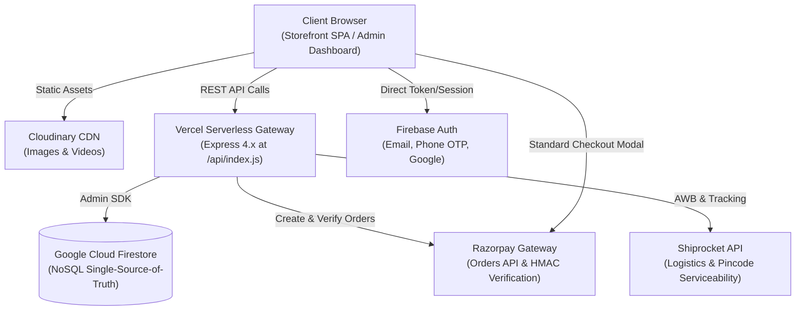

# Kalyan Covering Store — Master Technical Architecture & Specification

> **Official Blueprint for Human Developers & AI Agents**  
> *Stack: Vanilla HTML5/ES6+ Modules, Vite 5, Express 4.x Serverless (Vercel), Google Cloud Firestore, Razorpay, Cloudinary, Shiprocket*

---

## 📑 Quick Access & Download Links

- 📥 **Download PDF Architecture Blueprint**: [Kalyan_Covering_Architecture_Document.pdf](file:///c:/KALYAN_COVERING_STORE/Kalyan_Covering_Architecture_Document.pdf)
- 📂 **Artifact Folder Copy**: [Kalyan_Covering_Architecture_Document.pdf](file:///C:/Users/DIVYA/.gemini/antigravity-ide/brain/ef81d5d4-b36e-4269-a14f-c417126d0de9/Kalyan_Covering_Architecture_Document.pdf)
- 🔍 **Bug Audit Report**: [BUG_REPORT.md](file:///c:/KALYAN_COVERING_STORE/BUG_REPORT.md)
- 📋 **Migration & Refactor Plan**: [implementation_plan.md](file:///c:/KALYAN_COVERING_STORE/implementation_plan.md)

---

## 1. System Overview & Core Philosophy

**Kalyan Covering** is an enterprise Indian jewelry e-commerce brand specializing in 1-gram gold-plated micro-covering ornaments, bridal sets, rings, and bangles. 



### Non-Negotiable Core Invariants
1. **Zero Client-Side Pricing Trust**: The client never calculates order totals or discounts. All pricing is recalculated from Firestore products before calling Razorpay.
2. **Two-Phase Payment Commitment**: Orders are marked `PENDING` until a server-side cryptographic HMAC SHA256 signature verification succeeds.
3. **Decoupled Modular Styling**: Vanilla CSS utilizing CSS Custom Properties in `design-system.css` and `components.css`. No heavy CSS frameworks like Tailwind or Bootstrap.
4. **Atomic Inventory Locks**: Stock deductions use Firestore transactions in `server/lib/stock.js` to eliminate race conditions.

---

## 2. Directory Structure & File Map

```
c:\KALYAN_COVERING_STORE\
├── public/                     # Vite Frontend Root
│   ├── customer/               # Storefront Pages
│   │   ├── index.html          # Homepage with trending collections
│   │   ├── products.html       # Catalog listing, filtering, search
│   │   ├── product-detail.html # Product details, size guide, reviews
│   │   ├── cart.html           # Shopping cart & coupon entry
│   │   ├── checkout.html       # Address form & payment trigger
│   │   ├── order-success.html  # Post-purchase confirmation
│   │   ├── my-orders.html      # Order history & status
│   │   ├── order-details.html  # Line items, tracking, invoice link
│   │   ├── invoice.html        # Downloadable/Printable PDF invoice
│   │   ├── auth.html           # Customer login, register, OTP
│   │   └── profile.html        # Customer profile & addresses
│   ├── admin/                  # Admin Management Portal
│   │   ├── admin-login.html    # Secure admin authentication
│   │   └── dashboard.html      # 400KB Full-featured Single Page App
│   ├── css/                    # Modular Style Sheets
│   │   ├── design-system.css   # Color tokens, typography, radii
│   │   ├── components.css      # Modals, buttons, badges, cards
│   │   ├── customer.css        # Storefront specific layouts
│   │   └── admin.css           # Admin tables, drawers, metrics
│   └── js/                     # Modular JavaScript Architecture
│       ├── components/         # Reusable UI components (Navbar, Modal)
│       ├── services/           # Data services (product, cart, payment)
│       ├── store/              # Reactive state manager (state.js)
│       ├── utils/              # Cloudinary, validation helpers
│       ├── firebase-config.js  # Firebase client & Vercel API caller
│       └── rbac.js             # Role-based access control UI
├── api/index.js                # Vercel Serverless Function entrypoint
├── server/                     # Backend API Microservices
│   ├── lib/                    # Firebase Admin SDK, stock locking
│   ├── middleware/             # Bearer auth, RBAC, Rate limiter
│   └── routes/                 # Express routers:
│       ├── payments.js         # Razorpay order create, verify, refund
│       ├── orders.js           # Order placement, status, cancellations
│       ├── products.js         # Catalog CRUD, pricing, search
│       ├── shipping.js         # Shiprocket courier tracking
│       ├── invoices.js         # PDFKit server-side invoice generation
│       └── admin.js            # Admin analytics, audit logs, staff
├── scripts/                    # Maintenance & Diagnostics
│   ├── check-razorpay-keys.js  # Live/Test key diagnostic CLI
│   └── generate-architecture-pdf.js # Architecture PDF compiler
└── firestore.rules             # Production database security rules
```

---

## 3. Database Schema (Cloud Firestore)

| Collection | Key Fields | Purpose |
|---|---|---|
| `products` | `id, name, price, originalPrice, category, stock, images[], status, createdAt` | Authoritative catalog data |
| `orders` | `orderId, uid, items[], pricing{}, address{}, payment{}, shipping{}, createdAt` | Full order lifecycle |
| `users` | `uid, email, displayName, phone, role ('customer'\|'staff'\|'manager'\|'owner')` | User accounts & permissions |
| `coupons` | `code, type ('percent'\|'fixed'), value, minOrder, maxDiscount, status, expiresAt` | Promotional discounts |
| `reviews` | `productId, uid, customerName, rating (1-5), comment, photoUrl, createdAt` | Customer feedback |
| `audit_logs` | `timestamp, actorUid, actorEmail, action, resource, details{}` | Security compliance |

---

## 4. Razorpay Payment Integration & Testing

### Complete Sequence
1. **Cart Submission**: Browser posts items to `POST /api/payments/create-order`.
2. **Server Verification**: Server re-fetches products from Firestore, computes total in paise.
3. **Razorpay Order**: Calls `rzp.orders.create({ amount, currency: "INR", receipt })`.
4. **Modal Checkout**: Frontend opens `new Razorpay(options)` modal.
5. **Verification**: Browser posts `razorpay_order_id`, `razorpay_payment_id`, `razorpay_signature` to `POST /api/payments/verify`.
6. **HMAC Cryptographic Validation**:
   ```javascript
   const expectedSignature = crypto
       .createHmac("sha256", process.env.RAZORPAY_KEY_SECRET)
       .update(`${orderId}|${paymentId}`)
       .digest("hex");
   if (expectedSignature === signature) {
       // Mark order as PAID & decrement inventory
   }
   ```

### Testing Credentials
- **CLI Diagnostic**: Run `npm run check:razorpay`
- **Test UPI**: `success@razorpay`
- **Test Card**: `4111 1111 1111 1111`, Expiry: Future date, CVV: `123`, OTP: `123456`

---

## 5. Software & Tools to Detect Code Bugs

1. **SonarLint (VS Code)**: Instant in-editor detection of security flaws, unhandled exceptions, and dead code.
2. **Sentry**: Real-time error tracking with stack traces on production user devices.
3. **Postman / Bruno**: Automated regression testing of backend REST APIs.
4. **Chrome DevTools (Lighthouse & Network)**: Performance audit, 30s network timeout monitoring.
5. **ESLint & Prettier**: Static linting to catch missing `async/await` and undefined selectors.

---

## 6. Action Checklist (Pending Priorities from Audit)

- [ ] **Fix 30-Second API Timeout**: Update `public/js/firebase-config.js:101` from 30s to 60s with retry logic for mobile networks.
- [ ] **Quick View Modal Fix**: Inject `#quick-view-modal` HTML template in `index.html` and `products.html`.
- [ ] **Size Guide Modal Fix**: Change `modal.classList.add('on')` to `modal.classList.add('open')` in `product-detail.html`.
- [ ] **Cloudinary Upload Presets**: Configure `kalyan_reviews` and `kalyan_videos` in Cloudinary settings.
- [ ] **Order Cancellation Persistence**: Connect cancel and return buttons in `orderService.js` to Firestore.
- [ ] **Razorpay Webhooks**: Implement `POST /api/payments/webhook` for dropped client sessions.

---

## 7. Master AI Handover Directive

*Copy and paste the block below into any new AI (ChatGPT, Claude, Cursor, v0):*

```markdown
### SYSTEM CONTEXT & ARCHITECTURAL DIRECTIVE FOR KALYAN COVERING STORE

You are the Lead Full-Stack Engineer for Kalyan Covering (https://kalyancoveringstore-c53e4.web.app).
Adhere strictly to the established architecture:

1. ARCHITECTURE & TECH STACK:
   - Frontend: Vanilla HTML5, Vanilla ES6+ JavaScript modules, Vite 5.
   - Styling: Vanilla CSS (public/css/design-system.css, components.css). DO NOT introduce TailwindCSS.
   - Backend: Express 4.x running as Vercel Serverless Functions (/api/index.js) and /server/routes/*.
   - Database: Google Cloud Firestore (collections: products, orders, users, coupons, settings, audit_logs).
   - Auth: Firebase Authentication (Email/Password, Phone OTP, Google OAuth).
   - Payments: Razorpay Standard Checkout + Server HMAC SHA256 Verification in /server/routes/payments.js.

2. NON-NEGOTIABLE CORE INVARIANTS:
   - ZERO CLIENT PRICING TRUST: Client never sends prices; server calculates them from Firestore.
   - CRYPTOGRAPHIC HMAC VERIFICATION: Orders only become PAID after HMAC SHA256 matches.
   - ATOMIC INVENTORY: Decrement stock via server/lib/stock.js transactions.
   - PRESERVE DOM CONVENTIONS: Use .modal.open, .toast, .btn-primary.

3. KEY DIRECTORIES:
   - Storefront UI: public/customer/*.html
   - Admin Single-Page Portal: public/admin/dashboard.html
   - Frontend Services: public/js/services/*.js
   - Backend Controllers: server/routes/*.js

Please confirm you understand these architectural constraints before proceeding.
```
